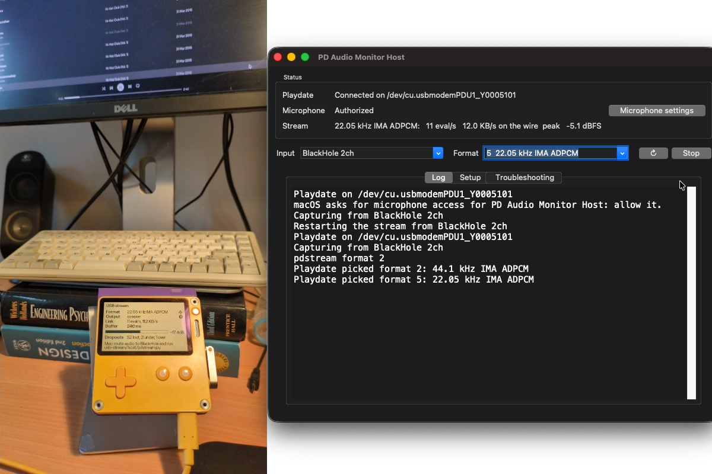

# usb-stream: PD Audio Monitor Host and Receiver



Plays Mac or Windows audio on the **Playdate's speaker** over the USB cable, encoded in a Playdate audio
format. The signal stays digital end to end, so there's none of the analog noise of
[`line-in-monitor`](../line-in-monitor/).

```
DAW / any app ──► BlackHole 2ch ──► pdstream.py ──USB serial `eval`──────► receiver app ──► speaker
                  (virtual output)  decimate + encode                       decode + interpolate
```

The two halves are the format chain split in two (`shared/codec/format_stream.c`): what plays
equals `chain_render` (and the line-in monitor's emulation) sample for sample.

## Installation

Needs an Apple Silicon Mac on macOS 26 or later and a Playdate.

1. Download `PD-Audio-Monitor-Host-…-macos-arm64.zip` and `PDAudioMonitorReceiver-….pdx.zip` from
   the [latest release](https://github.com/ninovanhooff/pd-audio-monitor/releases/latest).
2. Sideload the receiver: upload the pdx zip at [play.date/account/sideload](https://play.date/account/sideload),
   or unzip it into the Playdate's `Games` folder in Data Disk mode.
3. Install [BlackHole](https://existential.audio/blackhole/) 2ch: `brew install blackhole-2ch`.
4. In **Audio MIDI Setup**, set BlackHole 2ch to **44.1 kHz**.
   To also hear the Mac, create a *Multi-Output Device* with BlackHole and your
   headphones. The Playdate plays a few hundred ms later.
5. Send audio to BlackHole (or the Multi-Output Device), either as the system output or as your
   DAW's output device.
6. Unzip PD Audio Monitor Host and move it to Applications. It isn't notarized, so the first time,
   right-click it and choose **Open**.
7. Connect the Playdate over USB, unlock it, and start PD Audio Monitor Receiver. Then open
   PD Audio Monitor Host: it finds the Playdate and starts streaming from BlackHole.
8. Allow microphone access when macOS asks: that is how the host app hears BlackHole. Nothing is
   recorded from a microphone.

### Windows

Needs Windows 10 or later and a Playdate. The Playdate shows up as a COM port without a driver.

1. Download `PD-Audio-Monitor-Host-…-windows-x64.zip` and `PDAudioMonitorReceiver-….pdx.zip` from
   the latest release, and sideload the receiver as above.
2. Install [VB-Cable](https://vb-audio.com/Cable/) and restart Windows.
3. Send audio to **CABLE Input**, either as the system output or as your player's or DAW's output
   device. To also hear it on the PC, tick *Listen to this device* on CABLE Output's properties
   (Recording tab).
4. Connect the Playdate over USB, unlock it, start PD Audio Monitor Receiver, then run
   PD Audio Monitor Host. It isn't signed, so SmartScreen asks once: *More info → Run anyway*.

To build it, install Python, MinGW-w64 gcc and `pip install numpy pyserial sounddevice pyinstaller`, then:

```bash
gcc -std=c11 -O2 -shared -static-libgcc -Ishared/codec -o usb-stream/host/libpdstream.dll usb-stream/host/encoder.c shared/codec/format_stream.c shared/codec/format_chain.c shared/codec/ima_adpcm.c
cd usb-stream/host && python -m PyInstaller --noconfirm --workpath build/app --distpath dist host.spec
```

`pdstream.py --device` defaults to `CABLE Output` on Windows.

The host app's Setup and Troubleshooting tabs repeat these steps and cover the usual problems.
If the serial port is busy, quit the Playdate Simulator; it also talks to the device over USB.

## On the Playdate

| Row | Shows |
| --- | --- |
| Format ✛ | Format of the incoming stream. ⬅/➡ pick the sample rate, ⬆/⬇ the codec (more bits up: 16-bit, 8-bit, ADPCM); the Playdate asks `pdstream.py` to switch and shows `...` until it does. Both wrap around. `--format` sets the starting format, and the host app's Format menu switches it too |
| Output Ⓑ | Speaker / headphones / both |
| Link | `eval` packets and bytes arriving per second |
| Buffer | Audio queued. Playback starts at 150 ms; above 400 ms it drops back to 150 ms (clock drift). |
| meter | Peak level, or `CLIP` when the stream hits full scale |
| Dropouts | Lost packets (sequence gaps), buffer underruns and overruns |

## Formats and link load

| # | Format | `eval`/s | KB/s on the wire |
| --- | --- | --- | --- |
| 0 | 44.1 kHz 16-bit (bypass) | 87 | 96 |
| 1 | 44.1 kHz 8-bit | 44 | 48 |
| 2 | 44.1 kHz IMA ADPCM | 22 | 24 |
| 3 | 22.05 kHz 16-bit | 44 | 48 |
| 4 | 22.05 kHz 8-bit | 22 | 24 |
| **5** | **22.05 kHz IMA ADPCM** (default) | **11** | **12** |
| 6 | 11.025 kHz 16-bit | 22 | 24 |
| 7 | 11.025 kHz 8-bit | 11 | 12 |
| 8 | 11.025 kHz IMA ADPCM | 6 | 6.1 |

A Playdate takes about 86 `eval`s a second (measured with the bypass), so every format plays.

## Development

### Build and run

Building needs the Xcode command line tools, and the receiver needs the Playdate SDK.

1. Build the encoder library and install the Python packages:

   ```bash
   make -C usb-stream/host
   python3 -m venv ~/.venvs/pdstream
   ~/.venvs/pdstream/bin/pip install numpy pyserial sounddevice
   ```

2. Build the receiver, `PDAudioMonitorReceiver.pdx`, and install it on a USB-connected Playdate:

   ```bash
   export PLAYDATE_SDK_PATH=~/Developer/PlaydateSDK
   scripts/quickinstall.sh -i usb-stream/receiver
   ```

3. Run the streamer from the command line:

   ```bash
   ~/.venvs/pdstream/bin/python usb-stream/host/pdstream.py          # default 22.05 kHz IMA ADPCM
   ~/.venvs/pdstream/bin/python usb-stream/host/pdstream.py --help   # formats, --device, --port, --input file.wav
   ~/.venvs/pdstream/bin/python usb-stream/host/pdstream.py --format 0             # bypass
   ```

   Run this way, the microphone access belongs to the app running it (Terminal, iTerm, ...).
   Without it, macOS hands the capture silence, so `pdstream.py` checks at start and stops if
   access is denied: allow that app under **System Settings → Privacy & Security → Microphone**,
   then restart it.

4. Or build what the release ships (needs `pip install pyinstaller` in the venv, and Tk for the app:
   `brew install python-tk`):

   ```bash
   make -C usb-stream/host bundle PYTHON=~/.venvs/pdstream/bin/python   # dist/pdstream, one executable
   make -C usb-stream/host app PYTHON=~/.venvs/pdstream/bin/python      # dist/PD Audio Monitor Host.app
   open "usb-stream/host/dist/PD Audio Monitor Host.app"
   ```

   `dist/pdstream` takes the same options as `pdstream.py` and runs without Python on Macs with the
   same CPU (each start unpacks it first, which takes about 3 s). The app asks microphone access for
   itself. Each build has a new signature, so after a rebuild you may need to allow it again:
   `tccutil reset Microphone nl.ninovanhooff.pdstream`.

### Protocol

Each packet is up to 1024 raw bytes inside `eval <length>\n<Lua bytecode>`. The bytecode is a call
`pdstream_feed("<packet>")`, built around the packet from a template that equals pdc's output
(`EVAL_HEAD` in `pdstream.py`; the tests compare it with pdc). The receiver's empty `main.lua`
starts the Lua runtime that `eval` runs in; C registers `pdstream_feed` and sets its update callback
once that runtime is up (`kEventInitLua`). `eval` doesn't work in apps from Catalog, so the receiver
has to be sideloaded.

`pdstream.py` sends `echo off` when it opens the port. A packet holds:

| Bytes | Field |
| --- | --- |
| 0 | Format number (`chain_formats` index) |
| 1 | Sequence number, wrapping at 256 |
| 2–3 | Offset of the first data byte within its unit (uint16 LE) |
| 4… | Stream bytes: 16-bit LE or 8-bit signed samples at the format's rate, or WAV-layout ADPCM blocks |

The other way, the receiver logs `pdstream format <n>` to its console, which goes out over USB, once
a second until the stream arrives in that format. `pdstream.py` switches its encoder and keeps the
sequence numbers running.

After a gap in the sequence numbers, the receiver skips to the next unit boundary and goes on.
For ADPCM that is the next block. A new format number restarts the decoder.

Why C: Lua can't feed PCM to the audio engine, so the `eval` packets go straight to a C function.

### Test

- `tests/run_tests.sh`: on the host, `pdstream.py` writes its `eval` commands for a test signal and
  the receiver's `packet.c` decodes them. Every format must equal `chain_render` bit for bit,
  decoding must recover after two dropped packets, and, with pdc on the PATH, the bytecode must
  equal pdc's.
- `tests/sim_e2e.sh` (headless Linux): the Simulator has no serial input, so the receiver replays
  recorded commands from `replay.bin` in its data folder, taking the packets out of the bytecode.
  The check records its output and compares it with `chain_render` (−82 dB residual).
